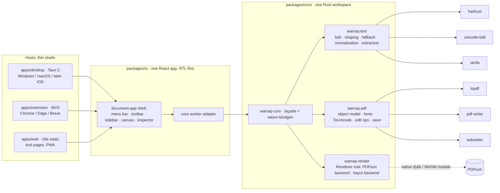

# Architecture

## Principles (from the brief, made concrete)
* **One core, two builds.** `packages/core` compiles to a native library (linked into Tauri; later iOS via FFI) and to `wasm32-unknown-unknown` (extension, web). CI builds both on every commit; a feature that compiles for only one target fails the build (`cargo check --target wasm32-unknown-unknown` is a required job).
* **One UI.** `packages/ui` is the whole product surface. A host provides only: file open/save, window/OS integration, storage for settings and cloud tokens, and the way the core module is loaded (worker in the browser, offscreen document in the extension, worker in Tauri's webview plus native commands for heavy jobs).
* **RTL-first CSS.** Logical properties only (`margin-inline-start`, `inset-inline-end`, `text-align: start`); `dir` on `<html>` follows the UI language; icons that imply direction (back, next, indent) are mirrored with `[dir=rtl]` rules; stylelint rule `csstools/use-logical` enforces it.
* **Hostile input.** Parsing and rendering run outside the UI thread and, on desktop, in a separate process (`warraq-renderd`, Phase 2). The WASM build is sandboxed by the browser. No `eval`, strict CSP (`script-src 'self' 'wasm-unsafe-eval'`), no network calls without a user action (verified by an egress test in CI).
* **Original never lost.** The opened bytes are kept immutable; edits are an operation log applied on save (incremental update when possible, full rewrite when the file is broken or encrypted with a changed key).

## Crates
| Crate | Responsibility | Key dependencies |
|---|---|---|
| `warraq-text` | Unicode bidi (UAX #9), OpenType shaping, script/direction itemization, font fallback chain (bundled OFL fonts + user fonts), Arabic-aware normalization and search, logical-order reconstruction from positioned glyphs | harfrust, skrifa, unicode-bidi, unicode-normalization, unicode-script |
| `warraq-pdf` | Document model over `lopdf` (read/modify/incremental save), font embedding and subsetting with ToUnicode, text object writing/editing, page operations, the standard security handler, signature fields and `/DSS` | lopdf, pdf-writer, subsetter |
| `warraq-render` | `Renderer` trait with `Pdfium` (native + WASM shim) and `Hayro` (pure Rust) backends; page bitmaps; glyph device for extraction | pdfium-render (feature), hayro, hayro-interpret |
| `warraq-sign` | PDF digital signatures (PAdES B-B/T/LT/LTA): PKCS#12, CMS SignedData, RFC 3161, OCSP/CRL, certificate paths against Mozilla's roots and the person's own, and the verifier; the PDF side (fields, `/ByteRange`, appearances, `/DSS`, changes after signing) is `warraq-pdf::signature`. Pure functions over bytes: the host sends and fetches | RustCrypto (`cms`, `x509-cert`, `rsa`, `p256`, `p384`, `pkcs5`…), `webpki-roots` |
| `warraq-core` | Façade used by hosts; `wasm-bindgen` exports mirroring `API.md`; error codes | all of the above |

## Rendering backends per target (Phase 1 state)
| Target | Rasterizer | Status |
|---|---|---|
| Desktop (Tauri, native core) | PDFium via pdfium-render, feature `pdfium` of `warraq-render`; `libpdfium.dylib` is bundled as an app resource and located through `PDFIUM_LIB_DIR` | done: `apps/desktop/src-tauri/src/core_bridge.rs` exposes the whole core API as Tauri commands (pixels travel as a raw IPC body, never JSON) and `packages/ui/src/core/host-tauri.ts` routes the UI to them; `core_engine()` reports the engine that actually bound, so a missing library degrades visibly to hayro |
| Web / extension (WASM core) | hayro (pure Rust) — shipped in the Phase 1 skeleton (core WASM 1.95 MB gzipped incl. rasterizer) | PDFium WASM shim (pdfium-render ↔ Emscripten module) is the next task; risk #2 in `02-decision.md` |

The `Renderer` trait keeps both backends behind one API so the swap is a build flag, not a code change in the UI.

## Data flow: open → render → edit → save
1. Host reads bytes → `Document::open(bytes)` in the worker.
2. UI asks `render_page(i, scale)` per visible page (tiles later) and draws RGBA into a canvas; thumbnails at scale 0.2.
3. `text_lines(i)` gives the selection overlay in logical order with per-line geometry.
4. An edit (Phase 2) creates an operation (`ReplaceText{page, run, old, new}`) → `warraq-pdf` re-shapes the affected paragraph with `warraq-text`, rewrites the content stream and font subsets → the page is re-rendered.
5. Save = incremental update appended to the original bytes (`PdfDocument::save_incremental`, verified against PDFium, qpdf and PDF.js), falling back to a full rewrite for encrypted files or files without a usable xref; the result is re-opened through the reader to verify the round trip.

## Repository layout
See the README; `prototypes/` (Phase 0) is a separate cargo workspace and is not part of the product build.
