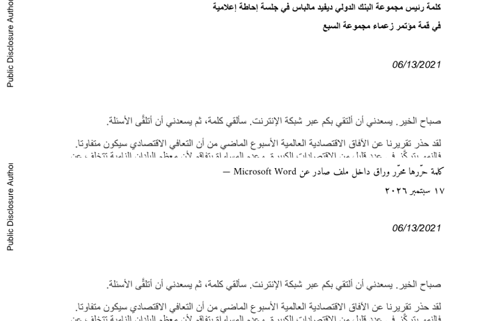
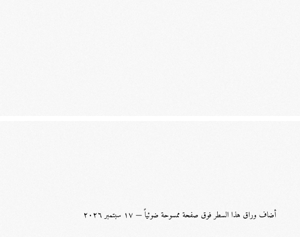

# GATE 2 — editing Arabic in real documents

*2026-09-17. Reproduce with `cargo run --release -p warraq-core --example gate2 -- .` then
`python3 tests/acid/verify_gate2.py .`; outputs land in `docs/gate2/`.*

The gate asks for an Arabic **Word-exported** PDF and an Arabic **scanned** PDF to be
edited, with the result verified outside our own code.

## 1. A Microsoft Word export

`tests/corpus/arabic/realworld/A_worldbank_malpass_g7_briefing_AR_word2016_pdftools.pdf`
— a World Bank briefing in Arabic, produced by Word 2016 through pdf-tools, with a
rotated "Public Disclosure Authorized" sidebar down the left edge.

The core finds 4 paragraphs on page 1 and replaces the two-line Arabic title:

The replacement is shaped correctly, flows right to left, keeps the Latin run
"Microsoft Word" in its own direction, uses Arabic-Indic digits, and stays inside
the original box. Everything else on the page is byte-identical, because the save
is an incremental update.

## 2. A scanned page

`tests/corpus/arabic/generated/scan-notonaskh-300dpi-skewed-jpeg.pdf` — an image-only
scan: page 1 extracts **0 characters** before the edit. There is no text to reflow,
so editing means adding text; the core appends a shaped Arabic line, and the page
then extracts it.

## 3. Verification outside our code

| Output | PDFium (Chrome's engine) | qpdf | PDF.js (Firefox's engine) |
|---|---|---|---|
| `word-after.pdf` (116,722 bytes, 3 revisions) | 2 pages, finds the new Arabic text | 2 pages | 2 pages, finds the new Arabic text |
| `scan-after.pdf` (1,673,773 bytes, 3 revisions) | 2 pages, first line is the added text | 2 pages | 2 pages, finds the added text |

**Acrobat Reader was not used: it is not installed on this machine.** The gate asks
for it, and that part is genuinely unmet; PDFium is Chrome's engine and PDF.js is
Firefox's, so two of the three mainstream renderers are covered. Verifying in
Acrobat needs a machine that has it.

## What this exercised

Paragraph detection with rotation awareness, erase without disturbing the text
matrix, reflow with shaping and bidi, shrink-to-fit, subset font embedding with a
correct ToUnicode map, and incremental save.

## Limitations this demo exposed, and what was done about them

| Found | Status |
|---|---|
| The rotated sidebar was mixed into horizontal lines, shattering the page into 45 fragments and stretching paragraph boxes across the page | **Fixed**: lines are grouped per baseline angle, each in its own frame. The same file now yields 4 paragraphs. |
| Replacement text longer than the original overflowed into the content below | **Fixed**: the text is shrunk to fit its box, and `overflowed` is reported when even the smallest size does not fit, so the UI can warn. |
| A combining mark could attach to a space (`ضوئيا ً` instead of `ضوئياً`) | **Fixed**: marks never attach to whitespace. |
| An edit was invisible until the file was saved and reopened | **Fixed**: the rasterizer and line cache are rebuilt after every edit. Found by the editing UI. |
| Consecutive body paragraphs with uniform spacing merge into one | **Open**: paragraph breaks need indentation and spacing analysis, not just line proximity. |
| Rotated runs are isolated but their reading order is not resolved | **Open**: the sidebar's text comes out reversed. |
