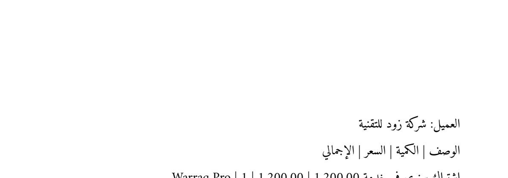
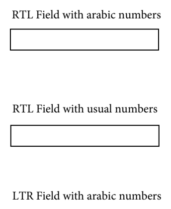

# EmbedPDF spike: does its PDFium engine do the missing tools on Arabic files?

*2026-09-18. Script: `prototypes/embedpdf-spike/spike.mjs` (`pnpm install && pnpm spike`
inside that folder). It runs EmbedPDF 2.15.1's own engine — `PdfiumNative` over
`@embedpdf/pdfium`'s WASM build — headless in Node against files from
`tests/corpus/arabic/`, saves each result, reopens it, and renders it to PNG so a
person can look at the letters. Everything below was observed, not assumed.*

## Why this spike

The owner asked for every tool to work, built on proven open-source code rather
than from scratch. The GitHub survey (live star counts and licence files read on
2026-09-18) left one candidate that is both feature-rich and licence-compatible:

| Project | Stars | Licence as read from the repository | Usable as Warraq's foundation |
| --- | --- | --- | --- |
| Stirling-PDF | 92,471 | MIT core, but `engine/`, `app/proprietary/` and the desktop app (`frontend/editor/src/desktop/`) are under the "Stirling PDF User License": production use requires a paid subscription | No — a commercial competitor, not a free base |
| BentoPDF | 15,591 | AGPL-3.0 | Only by making Warraq AGPL; its added-text path is weak on Arabic |
| **EmbedPDF** | 4,493 | `@embedpdf/*` SDK Apache-2.0 per `LICENSING.md` (npm packages declare MIT); only the CloudPDF server is FCL-1.0 | **Yes** |
| pdf.js | 53,893 | Apache-2.0 | A viewer with basic annotation, not an editor |
| qpdf / OCRmyPDF / pdfcpu | 5–35k | Apache-2.0 / MPL-2.0 / Apache-2.0 | As components |

## What EmbedPDF's engine already does

The `PdfiumNative` class exposes real PDFium operations for most of the tools the
interface was only labelling "Later": `deletePage`, `extractPages`, `importPages`,
`merge`; `createPageAnnotation`, `addTextMarkupContent`, `addStampContent`,
`addShapeContent`, `flattenAnnotation`; `setFormFieldValue`,
`regenerateWidgetAppearances`; `setDocumentEncryption`, `removeEncryption`;
`redactTextInRects`, `applyRedaction`; `addPngImageObject`, `addJpegImageObject`;
`setMetadata`, bookmarks, attachments; `saveAsCopy`. Its plugins wrap them in a
React/Preact UI: annotation, form, signature, redaction, stamp, and page-edit
(the last only in the 3.0 pre-release).

`pdfium.wasm` is 4.6 MB, **2.04 MB gzipped** — with Warraq's own core (2.55 MB)
about 4.6 MB, inside the 8 MB budget (N8).

## Results on Arabic files

| Operation | File | Result |
| --- | --- | --- |
| Redact the top band | `generated/raw-amiri-cid-identity-tounicode.pdf` | ✅ **Real removal.** Extracted text before: title, invoice number, date, client…; after: starts at "العميل". The rest of the page's Arabic renders untouched.  |
| Set a password | same | ✅ **AES-256** (`/V 5 /R 6 /CFM /AESV3`). Refuses to open without it; opens with the Arabic password "سر123" and extracts |
| Merge | invoice + Word export | ✅ 1 + 2 pages → 3 |
| Render existing Arabic | all | ✅ Correct and well shaped |
| Fill an AcroForm field with "محمد الغماس ١٢٣" | `realworld/F_pdfjs15546_rtl_acroform_textfields_arabic_digits_acrobat.pdf` | ⚠️ The **value is stored correctly** (`/V` in UTF-16BE, read back intact), but the field **renders empty**: PDFium drew its appearance with the field's standard font, which has no Arabic glyphs.  |
| Add a FreeText comment "تعليق عربي للاختبار" | `realworld/A_worldbank_…_word2016_pdftools.pdf` | ⚠️ Saved correctly — `/Contents` holds the Arabic, `/Rect` is where it was placed — but its appearance stream uses `/Helv 16 Tf`: **nothing visible is drawn**. EmbedPDF's FreeText type only accepts the 14 standard fonts |

Registering EmbedPDF's Arabic fallback font (`@embedpdf/fonts-arabic`, Noto Naskh
Arabic, OFL) changed neither ⚠️ result: fallback fonts help PDFium *render* text in
fonts a file does not embed, not *generate* appearances for new text.

## Conclusion

EmbedPDF does the heavy, structural work correctly on Arabic documents — the
operations where getting it wrong would be dangerous (redaction that merely
paints, encryption that is weak) are right. Its one gap is a single, narrow
thing: **drawing new Arabic text into an appearance stream**. Both ⚠️ rows share
that root cause, and it is exactly what Warraq's engine already does for text
editing — HarfRust shaping, a subset of a bundled face embedded with a correct
ToUnicode. So the foundation is EmbedPDF, and Warraq's core contributes the
Arabic appearance generator (plus the Arabic reading and paragraph editing no
other engine does). See ADR-0007.
