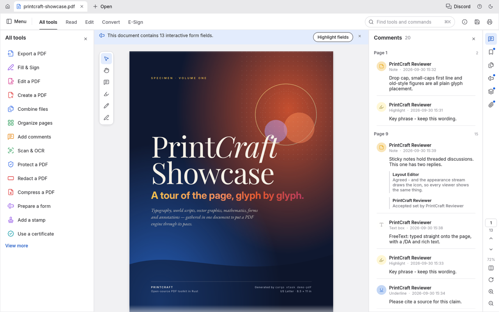
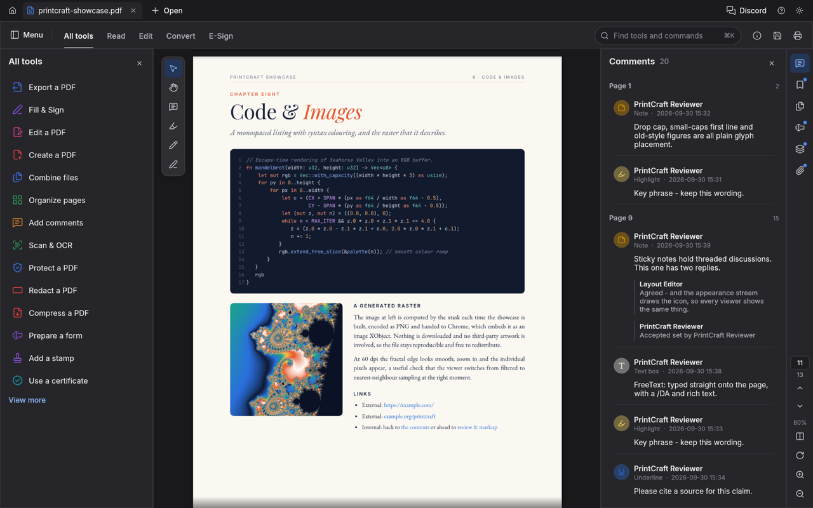
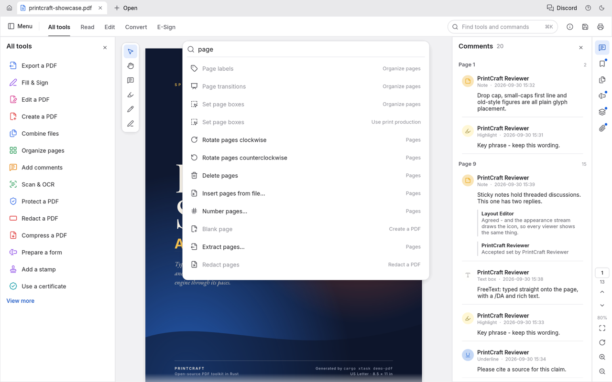
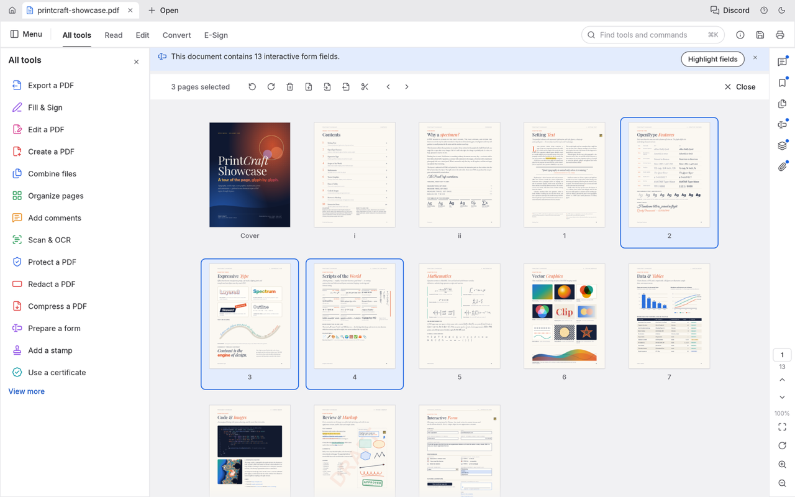
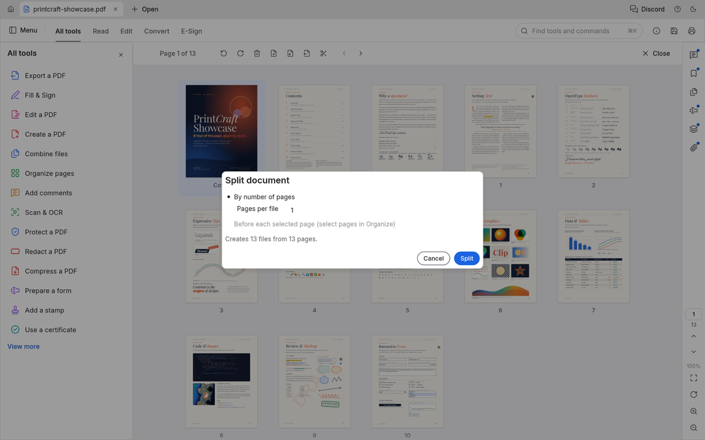
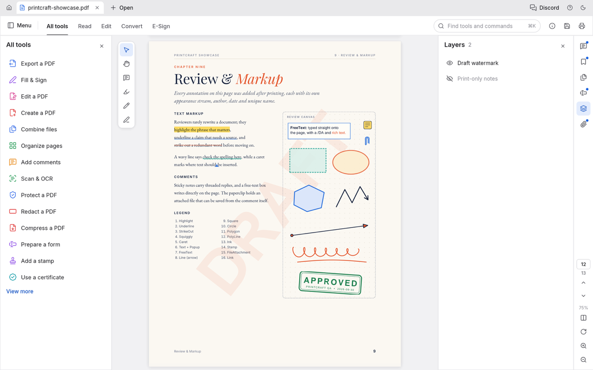
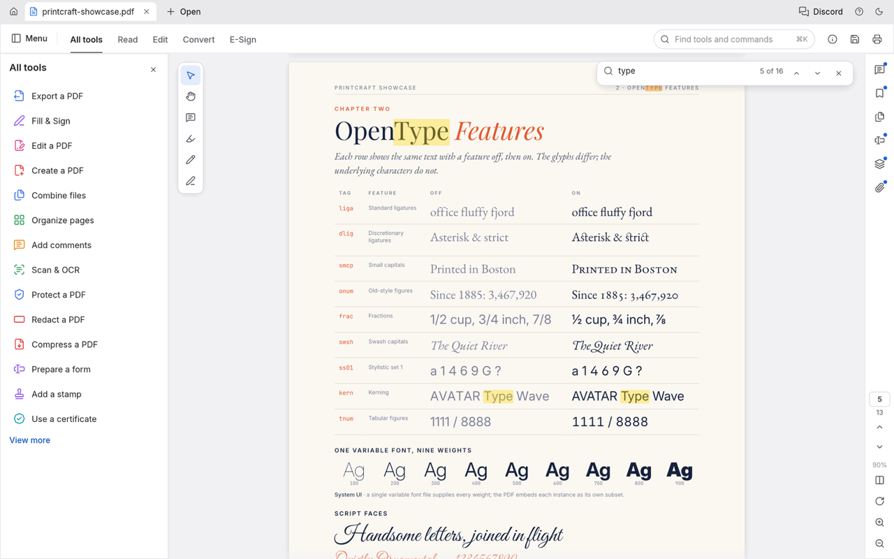

# The "Workbench" theme: PdfCraft's look and organisation, in محرر PDF (2026-10-14)

The owner wants a theme in Settings that reproduces PdfCraft's visual design and the way it is
organised, beside our Liquid Glass and Zood themes. This document has two parts:

1. **What PdfCraft's visual system is**, with exact values from `crates/ui-egui` at commit `7437bde`
   (`src/` below means `crates/ui-egui/src/`).
2. **How we build it in our own UI**, mirrored for Arabic.

It is a specification only. No product code changes here.

**Name.** In the app the theme is called **Workbench** (Arabic: **منضدة العمل**). We never call it
"PdfCraft" or "ArtCraft", and it carries none of their marks. PdfCraft describes itself as a "PDF
workbench", and the word itself is generic.

## Screenshots (credit)

The images in [`pdfcraft-shots/`](pdfcraft-shots/) were made by PdfCraft contributors. They are
generated by PdfCraft's `cargo xtask screenshots`, licensed MIT OR Apache-2.0, taken from
`docs/images/` at commit `7437bde`, and downscaled to 1,280 px wide. They show an older build's name,
"PrintCraft". `pdfcraft-tools.png` was **left out** because it shows the ArtCraft trademark.

| | |
|---|---|
|  Viewer: tab strip, mode bar, All tools, floating quick bar, Comments panel, right rail |  Dark theme |
|  Command palette (⌘K) |  Organize pages |
|  A modal dialog |  Layers panel |
|  Find | |

## Part 1. PdfCraft's visual system, from source

### Character in one paragraph

Flat, quiet, neutral grey, close to Acrobat's current shell:

- white chrome on a light grey pasteboard;
- one saturated blue accent;
- hairline 1 px borders, small 6 px radii, no glass and no gradients;
- Inter at 13 px;
- Lucide line icons at a 1.75 stroke, each tool family in its own hue.

What is distinctive is the **organisation**:

- documents as tabs at the top;
- a 48 px **mode bar** (Menu · All tools · Read · Edit · Convert · E-Sign, plus a search pill);
- **All tools** listed down the leading side, where a chosen tool replaces the list;
- a **floating quick bar** on the canvas;
- document panels on the trailing side, opened from a slim **icon rail** that also holds page
  navigation and zoom.

### Colour tokens (`src/theme.rs:71-121`)

| Token | Light | Dark | Used for |
|---|---|---|---|
| titlebar | `#E9E9EB` | `#1B1B1E` | tab strip |
| chrome | `#FFFFFF` | `#26262A` | mode bar, rail, panel headers |
| panel | `#FFFFFF` | `#26262A` | side panels |
| pasteboard | `#F1F1F3` | `#19191C` | behind the pages |
| card | `#FFFFFF` | `#2E2E33` | dialogs, popups, quick bar |
| border | `#DADADE` | `#3C3C43` | 1 px outlines |
| divider | `#E8E8EB` | `#333339` | 1 px separators |
| text | `#222226` | `#ECECEF` | |
| text_muted | `#5E5E66` | `#AEAEB6` | |
| text_faint | `#6B6B73` | `#97979E` | |
| icon | `#44444B` | `#D4D4DA` | |
| hover | `#F0F0F3` | `#34343A` | |
| pressed | `#E4E4E9` | `#3E3E45` | |
| selected | `#E6EEFD` | `#233A63` | |
| accent | `#1B63E0` | `#4B8BF5` | |
| accent_text | `#1755C4` | `#8CB6FA` | links, "View more" |
| accent_soft | `#E3ECFD` | `#243657` | selection wash |
| field | `#FFFFFF` | `#1E1E22` | inputs |
| badge_new | `#1B63E0` | `#3D7DEE` | |
| page_shadow | black α 34 | black α 120 | offset (0,3), blur 14; paper always white, square |

A test in their code holds text, text_muted and text_faint to WCAG AA (4.5:1) on chrome, panel, card
and pasteboard (`theme.rs:675-686`).

**Fixed colours used outside the tokens:**

- Status colours:
  - danger `#D7373F`;
  - error text `#D13B3B`;
  - warning `#E68619`;
  - success `#2D9D5B`;
  - the "Ready" chip has fill `#DDF3E4` and text `#1E7B43`.
- On the page:
  - selection `rgba(58,123,240,.27)`;
  - find hits `rgba(255,214,0,.35)`, with the current hit `rgba(255,140,0,.43)`;
  - objects `#1473E6`.
- Toast: `#2A2A2F` with white text in light; `#ECECEF` with `#222226` text in dark.
- **Tool-family hues** (`crates/engine/src/catalog.rs:53-59`):

  | Hue | Value |
  |---|---|
  | red | `#E03E3E` |
  | purple | `#8E4EE6` |
  | blue | `#3A6FE8` |
  | green | `#2D9D5B` |
  | orange | `#E88A1A` |
  | teal | `#149CA8` |
  | pink | `#D63B8F` |

**Light and dark.** They offer System, Light and Dark, named "Light gray" and "Dark gray". There is
no high-contrast variant. A click on the title-bar button cycles System → Light → Dark. "Reduce
motion" turns off the hover and press easing (0.12 s in, 0.06 s down, `theme.rs:146`). A press
drops the content by 1 px.

### Shape, spacing and sizes

**Radii and strokes**

- Widget radius 6; windows 10; menus 8; modal 10; controls inside dialogs 4; check box 3.
- Pills: radius 14 at 28 px high; icon pills radius 15 at 30 px high.
- Search box: radius 16 at 32 px high.
- Quick bar 12; palette 12; tab top corners 7; badges radius 4 at 16 px high.
- Every border is 1 px. The dialog focus stroke is 1.5 px accent.
- Shadows: window (0,8) blur 28 at α 38 light / 110 dark; popup (0,4) blur 16 at α 30 / 90.

**Spacing**

- Item spacing 8×6; button padding 10×5; menu margin 6.
- Fields: margin 10×6, minimum height 30.
- Modal padding 20×16.
- Scroll bar 8 px, floating (3 px when idle).
- Tooltip delay 0.35 s.

**Bars, panels and rows** (in order from top to bottom of the window)

| Element | Size and contents |
|---|---|
| Tab strip | 38 high; tabs 30 high, at least 180 wide, the name capped at 28 characters, a 15 px file icon, label 13 regular; a 20×20 close box; a 4 px dot for unsaved work; strip buttons 28 |
| Mode bar | 48 high, 1 px divider below. Mode tabs are text width + 22, medium 13.5 (semibold when active), with a **2 px accent underline**, hover well radius 6. Icon buttons 32; search pill 260 wide |
| Leading tools panel | default 272 (range 240–520), padding 14 · 10 · 12 · 10. Header 26 high, title semibold 15.5. **Tool rows 34 high, a 19 px hued icon, label regular 13.5 at x+36**, hover wash radius 6. The first 14 tools show, then "View more" |
| Tool detail | back chevron; section titles semibold 10.5, uppercase, letter spacing 0.6, text_faint; item rows 34 high with a 17 px icon and label 13 |
| Canvas | page gap 14, margin 28, a 70 px side gutter that keeps pages clear of the quick bar |
| Quick bar | floats at (14,14), card fill, 1 px border, radius 12, shadow (0,4) blur 16; buttons 32, spacing 2; flyout rows 180×28. Order: Select, Hand, then comment-group flyouts, then Fill & Sign |
| Trailing panel | default 330 (range 260–520), padding 14 · 12 · 12 · 8 |
| Right rail | 48 wide; panel buttons 34; a 3 px accent dot when a panel has content. At the bottom: a page field (34 wide, medium 12, radius 5), page count, previous and next, zoom %, fit, rotate, layout, zoom in and out. There is **no status bar** |
| Command palette | top + 96, 560 wide, radius 12, input regular 15, rows 36 with 17 px icons, each row naming its tool group at the end |
| Dialogs | a centred modal on a dim; widths 520 by default, Properties 640, Print 820, About 780; titles semibold 18 |
| Home | margin 36×28, heading semibold 24, tool cards 190×104, recent rows 46 |

### Type (`theme.rs:311-377, 426-437`)

- **Inter** (OFL) in Regular, Medium and SemiBold, and **JetBrains Mono** (OFL) for code.
- Styles: Body 13, Button 13, Small 11, Heading semibold 17.
- **No Arabic face is bundled.** Arabic falls back to an optional build input or the system's fonts.

### Icons

- **Lucide** (ISC): 186 SVGs on a 24 grid with the stroke redrawn at **1.75**, tinted in use; a
  glyph is half its button box (`src/icons.rs`).
- We already ship Lucide through `lucide-react`, so the icons need no new licence.

### Organisation

```
┌ tab strip 38 ─ [⌂] [doc.pdf ×] [doc2.pdf ×] [+ Open] ······················· [theme] [?] ┐
├ mode bar 48 ── [☰ Menu] │ All tools  Read  Edit  Convert  E-Sign ···· [🔍 Find tools ⌘K] [i] [💾] [🖶] ┤
├──────────────┬─────────────────────────────────────────────┬──────────────────┬────┤
│ All tools    │ ┌──┐  (optional notice bar: "13 form fields") │ Comments 20    × │ 💬 │
│ ▸ Export     │ │↖ │                                          │ Page 1           │ 🔖 │
│ ▸ Fill&Sign  │ │✋│        ┌───────────────┐                 │  …               │ ▤  │
│ ▸ Edit       │ │💬│        │     page      │                 │                  │ ⌸  │
│ …14 rows     │ │✎ │        │               │                 │                  │ ≋  │
│ View more    │ └──┘ quick  └───────────────┘                 │                  │ 📎 │
│ (272)        │       bar          pasteboard                 │ (330)            │ 1/13│
└──────────────┴─────────────────────────────────────────────┴──────────────────┴ 48 ┘
```

**The modes.** Read hides the tools column; Edit opens Edit; Convert opens Export; E-Sign opens Fill
& Sign. Choosing a tool, from the list, the palette or a mode, swaps the leading column to that
tool's panel: back chevron, title, sections. The **canvas interaction** (select, hand, comment,
measure, crop and so on) is a separate state, shown by the quick bar. There is no ribbon and no
contextual second toolbar.

**The All tools order** (23 groups, `crates/engine/src/catalog.rs:61-528`):

- **Shown first (the 14):** Export a PDF · Fill & Sign · Edit a PDF · Create a PDF · Combine files ·
  Organize pages · Add comments · Scan & OCR · Protect a PDF · Redact a PDF · Compress a PDF ·
  Prepare a form · Add a stamp · Use a certificate.
- **After "View more":** Use print production · Measure objects · Compare files · Use guided actions
  · Prepare for accessibility · Apply PDF standards · Add search index · Use JavaScript · AI
  assistant.

**Trailing panels** (`lib.rs:181-198`): Comments, Bookmarks, Pages (thumbnails), Form fields, Layers,
Attachments, Signatures, Accessibility, Tags, Search, Compare.

**Right to left: theirs is not mirrored.**

- Arabic is the only RTL language (`i18n/mod.rs:200`). Its labels are reordered into visual order
  for drawing (`bidi.rs`), and nothing else changes.
- The rail, the panels, the quick bar and the mode bar stay on the same sides, and the base direction
  is always left to right (`bidi.rs`; the `ar.tsv` header).

## Part 2. Workbench in محرر PDF

### What changes, and what stays ours

| Stays ours (not themable) | Changes with Workbench |
|---|---|
| Every tool and its panel contents, the core, EmbedPDF's view | Colours, radii, shadows, type sizes (tokens) |
| Arabic fonts (our UI stack and Noto Sans Arabic; Amiri, Cairo and Noto Naskh in documents) | Window organisation: tab strip, mode bar, tools on the leading side, panels plus rail on the trailing side, floating quick bar |
| Full RTL mirroring with logical CSS properties | The tool list's look: hued icons, 34 px rows, a "View more" link |
| The no-façade rule: only working tools are listed (their planned rows and "Planned · M#" hints are **not** reproduced) | Command palette (also useful in the other themes) |
| The app name محرر PDF, our icon and the ZOOD brand assets | Dialog frame and widths |
| Liquid Glass and Zood remain; Workbench is a third choice | Home: their card and list rhythm (no community card) |

### Tokens

We add a theme axis beside the light/dark mode. The current `ThemeMode` (system, light or dark;
`state/preferences.ts`, `html[data-theme]`) stays as the **appearance**. A new `uiTheme` preference
(`glass` | `zood` | `workbench`) sets `html[data-ui-theme]`. The web and desktop app have only the
glass look today; iOS has Liquid Glass and Zood in `apps/ios/PDFEditor/Design/Themes.swift`.

`styles/tokens.css` gains one block per mode, `:root[data-ui-theme="workbench"]` for light and its
dark counterpart (under the same `prefers-color-scheme` and `data-theme` guards the file uses
today). The block re-points our existing semantic tokens, so components do not change:

| Our token | Workbench light | Workbench dark |
|---|---|---|
| `--window` | `#F1F1F3` (pasteboard) | `#19191C` |
| `--surface` | `#FFFFFF` | `#26262A` |
| `--surface-2` | `#E9E9EB` (tab strip) | `#1B1B1E` |
| `--accent` / `-hover` / `-pressed` | `#1B63E0` / `#1755C4` / `#134AAD` | `#4B8BF5` / `#6A9FF7` / `#8CB6FA` |
| `--accent-soft` | `#E3ECFD` | `#243657` |
| `--label` / `-2` / `-3` | `#222226` / `#5E5E66` / `#6B6B73` | `#ECECEF` / `#AEAEB6` / `#97979E` |
| `--fill-hover` / pressed | `#F0F0F3` / `#E4E4E9` | `#34343A` / `#3E3E45` |
| `--separator` / `-strong` | `#E8E8EB` / `#DADADE` | `#333339` / `#3C3C43` |
| `--glass`, `--glass-strong`, `--glass-panel`, `--glass-card` | solid `#FFFFFF` (no blur: `--glass-blur: none`) | solid `#26262A` / card `#2E2E33` |
| `--bg-wash-*` | transparent (no gradient) | transparent |
| `--r-xs` / `-sm` / `-md` / `-lg` | 4 / 6 / 8 / 10 | same |
| `--shadow-2` / `-3` | `0 4px 16px rgb(0 0 0 / 12%)` / `0 8px 28px rgb(0 0 0 / 15%)` | α 35 % / 43 % |
| `--red` / `--green` / `--orange` | `#D7373F` / `#2D9D5B` / `#E68619` | same |
| new `--hue-red` … `--hue-pink` | the seven family hues above | the same, lightened 10 % for dark contrast |

- **Contrast.** A new vitest, which we do not have yet, should check 4.5:1 for the label colours on every surface, as theirs does.
- **The document view.** `embed/embedTheme.ts` already themes EmbedPDF by `var(--…)`, so it follows
  without change.
- **The system accent override** (`tokens.css` ~l.285) is switched off under Workbench, so the blue
  is theirs.

**Type.** The interface stays on our `--font-ui` stack: SF Pro and Segoe UI for Latin, Noto Sans
Arabic and Geeza Pro for Arabic. We do **not** switch to Inter. Inter has no Arabic, and mixing it
with an Arabic system face looks uneven. Their *sizes* are applied: body 13, small 11, panel titles
15.5 semibold, dialog titles 18, section titles 10.5 uppercase with 0.6 tracking. Arabic has no
capitals, so for Arabic labels `text-transform` is dropped, tracking is 0, and the size rises to 11.5
so it stays legible.

**Icons.** We keep `lucide-react`, set `strokeWidth={1.75}` under Workbench through our `Icon`
component, and give each tool its family hue in `tools.ts`. That is a new optional `hue` field. It
is additive: the other themes ignore it.

### Layout: the parts that are not just colour

Workbench changes the shell. That is what the owner asked for ("the way it's organized"):

1. **Tab strip** (new `shell/TabStrip.tsx`, 38 px).
   - Home, then one tab per open document, then "+ Open".
   - We open one document at a time today, so the first version shows the open document as the
     single tab, plus the Combine and Compare windows as tabs where they exist.
   - True multi-document tabs are a separate, larger feature (state per document in `AppContext`).
     They are **not** required for the theme and are not faked: the strip shows only real documents.
2. **Mode bar** (new `shell/ModeBar.tsx`, 48 px), replacing `Toolbar.tsx` under this theme.
   - The menu button opens our existing `menuModel.ts` as a dropdown. On macOS the native menu bar
     stays.
   - The modes, each mapped to tools that exist today:
     - **All tools** opens the tools column;
     - **Read** hides the columns;
     - **Edit** opens `edit`;
     - **Convert** opens `export`;
     - **E-Sign** opens `fillSign`.
   - At the end: the search pill (the new palette, Ctrl/⌘+K), Properties, Save and Print.
3. **Tools column on the leading side.** Today `RightPane.tsx` shows the tools list, or a tool's
   panel, at the *inline-end*.
   - Under Workbench, the same component renders at the **inline-start**, 272 px (resizable 240–520
     with our `PaneResizer`).
   - A tool's panel replaces the list, under a back chevron. "View more" appears after the first 14
     tools, in their order mapped onto our tool ids. Groups without a tool of ours (search index,
     JavaScript console, print production) are simply absent.
4. **Panels and rail on the trailing side.** Today `LeftPane.tsx` holds bookmarks, attachments and
   layers at the inline-start.
   - Under Workbench it moves to the **inline-end**, 330 px. A new 48 px `shell/Rail.tsx` sits on the
     outer edge, with one button per pane we have (Bookmarks, Pages, Attachments, Layers, Signatures,
     Accessibility when it has results).
   - At the rail's foot: the page field, previous and next, zoom %, fit, zoom in and out. These move
     from the toolbar's `PageInput.tsx` and `ZoomControl.tsx`, which are reused, not rewritten.
5. **Floating quick bar.**
   - EmbedPDF's interaction modes (select, hand, annotate) and our markup bar (`markupBar.ts`) are
     drawn as a vertical card at the canvas's inline-start top corner (14,14), radius 12.
   - Its flyouts are 180×28 rows.
6. **Command palette** (new `shell/CommandPalette.tsx`).
   - 560 wide, 96 px from the top, rows 36, each naming its tool group.
   - Its data is `menuModel.ts` plus `tools.ts`. Matching uses our Arabic search folding, so
     "صفحه" finds "صفحة". It is offered in every theme.
7. **Dialogs.** `Dialogs.tsx` keeps its structure. Under Workbench the frame takes radius 10, padding
   20×16, a dim backdrop and their widths (520 by default, Print 820).

Implementation is one `data-ui-theme` attribute and CSS for the colours and frames, plus a
`ShellLayout` switch in `Shell.tsx` that arranges the same components in the Workbench order. No
tool code forks. The phone layout (sheet, 44 pt targets) stays as it is under every theme. Workbench
is a desktop and tablet arrangement, and below 768 px it falls back to our phone shell.

### Arabic, right to left

Theirs never mirrors. Ours must, and it does so by construction:

- **The whole shell is mirrored in Arabic.** All positions are written with logical properties
  (`inset-inline-start`, `padding-inline`, `border-inline-end`), which our stylelint already
  enforces. In Arabic:
  - the tools column is on the **right**;
  - the panels and rail are on the **left**;
  - the quick bar floats at the canvas's **top right**;
  - the tab strip runs right to left, with Home at the right edge;
  - the mode tabs read All tools, Read, Edit, Convert, E-Sign from the right;
  - the search pill and the Save and Print icons sit at the left end;
  - the "View more" link and the back chevron point the reading way (`ChevronRight` in Arabic).
- **Icons that show direction** (arrows, undo, the back chevron, "move right") are mirrored; icons
  that do not (search, print, layers) are not. That is the rule `Icon` already applies.
- **The page field and zoom** use the user's digits (Western or Arabic-Indic), as now.
- **Document pages** are not mirrored. Only the chrome is. Two-up order follows the document's own
  direction, as our view does today.
- **Tab names** use the document's title or file name with first-strong direction (`dir="auto"`), so
  an Arabic file name reads correctly in an English interface, and the reverse.
- **Arabic labels:** no uppercase or tracking (see Type); row height 34 is kept, since Arabic at 13.5
  fits in 34 with our line-height. The 28-character name cap counts grapheme clusters, not code
  units.
- **Tests:**
  - e2e at 1,280×820 in both languages: the column sides swap, the rail is on the left in Arabic, and
    nothing overlaps;
  - the palette finds an Arabic command with and without tashkeel;
  - the new token contrast test passes for both modes;
  - screenshots go in `docs/design/screenshots/workbench-*`.

### Settings

- In Settings → Appearance, a **Theme** choice: Liquid Glass · Zood · Workbench (Arabic: الزجاج
  السائل · زود · منضدة العمل). Beside it is the existing Light/Dark/System segmented control.
  Workbench supports both modes; Zood stays as its brand defines it.
- Every string goes in `en.json` and `ar.json`.
- On iOS a matching **Workbench** entry is possible in `Themes.swift`, as solid surfaces with the
  palette above. It is a smaller job, because iOS uses system bars and the window organisation does
  not change there.

### Effort (Opus 5.5 agent-hours)

| Part | Size | Hours |
|---|---|---|
| `uiTheme` preference, Settings control, i18n | small | 2–3 |
| Workbench tokens (light and dark), contrast test, EmbedPDF check | small | 3–5 |
| Shell arrangement: mode bar, tools column at the start, panes plus rail at the end, single-document tab strip | medium | 10–14 |
| Floating quick bar over EmbedPDF | small to medium | 4–6 |
| Command palette (all themes) | small | 4–6 |
| Hued tool icons, row and dialog styling | small | 2–3 |
| RTL and LTR e2e, screenshots, STATUS and design README | small to medium | 4–6 |
| **Total (desktop and web)** | **medium to large** | **29–43** |
| Optional: iOS Workbench palette | small | 3–5 |
| Optional, separate feature: real multi-document tabs | large | 20–30 |
